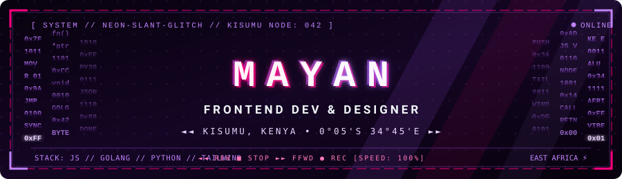

<div align="center">



<a href="https://github.com/Mayan-Okul">
  
</a>

</div>

## 🌸 About

Frontend dev and designer, still finding my footing, building software with real impact for Kenyan and East African communities.

<details>
<summary><b>👾 Click to open my status</b></summary>

```js
const mayan = new CyberEntity({
  role: "Frontend Developer & Designer",
  school: ["Zone01 Kisumu", "KCA University"],
  coreVibe: ["Dope UI", "React", "Design systems"],
  hardwareSync: true,
});

mayan.compile();
```

</details>

<details>
<summary><b>🚀 Click to see what I'm building</b></summary>

- **Mali**: AI-powered business OS for African SMEs ([live](https://mali-mnyapola.netlify.app))
- **Tembo**: water quality reporting platform for Lake Victoria
- **Forum**: Go + SQLite web forum (team project)

</details>

## 💻 Tech Stack

<div align="center">


</div>

## 📊 GitHub Stats

<div align="center">


</div>


<picture>
  <source media="(prefers-color-scheme: dark)" srcset="https://raw.githubusercontent.com/Mayan-Okul/Mayan-Okul/output/pacman-contribution-graph-dark.svg">
  <source media="(prefers-color-scheme: light)" srcset="https://raw.githubusercontent.com/Mayan-Okul/Mayan-Okul/output/pacman-contribution-graph.svg">
  
</picture>

## ✍️ Dev Quote

> *"The function of good software is to make the complex appear to be simple."*

## 🌐 Connect

<div align="center">

[](https://okulsportfolio.netlify.app/)


</div>
